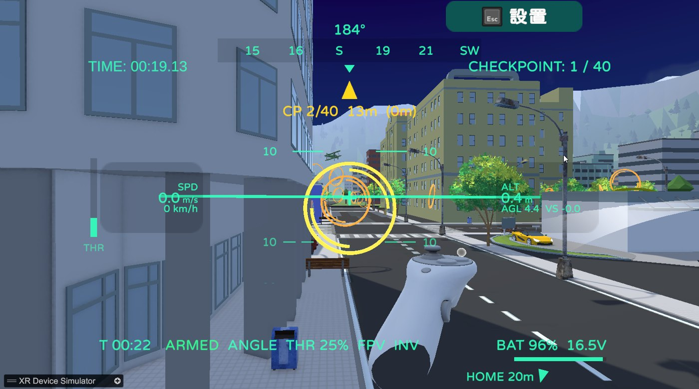
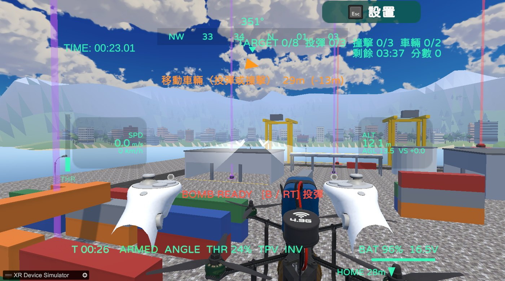
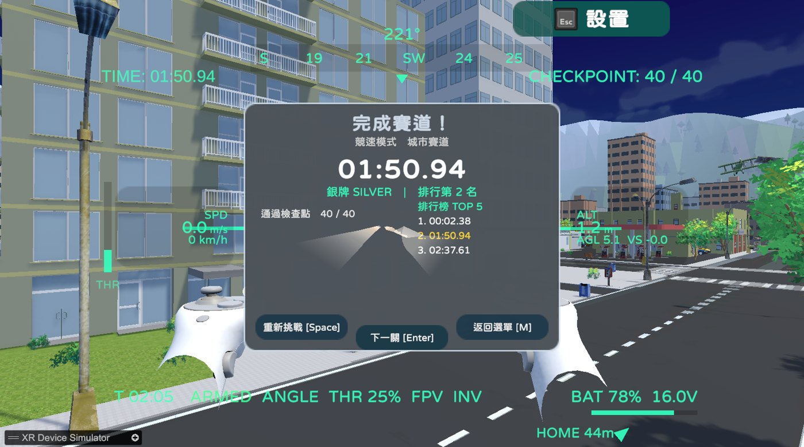
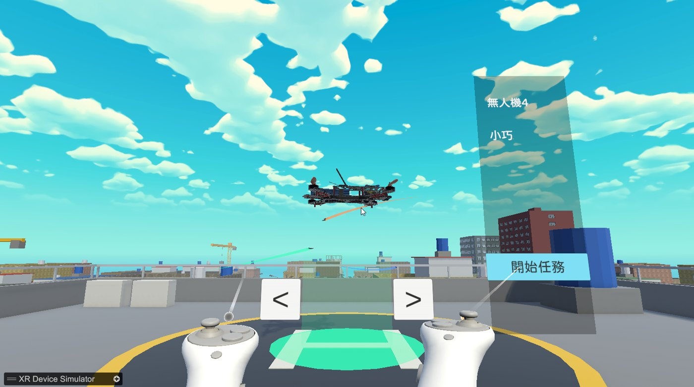

# Drone_Project202607

一個無人機VR模擬游戲，目前正在開發中
# 無人機 VR 飛行模擬遊戲（Drone_Project202607）

在城市中駕駛無人機，進行**穿圈競速**、**空中搬運**與**打擊演習**的 Unity 6 VR 飛行模擬遊戲。

中原大學資訊工程學系 115 學年度專題實驗　｜　指導老師：莊啓宏 教授
實作學生：陳星融、陳子謙、蔡喆宇



| 港區打擊演習 | 結算與排行榜 | 選擇無人機 |
|---|---|---|
|  |  |  |

---

## 專題動機

實體無人機在初學階段操作門檻高，操作不當容易造成設備損毀與安全隱患；傳統 2D 模擬軟體又難以還原三維空間的深度與距離感，使訓練與實際操作之間存在落差。

本專題以 VR 頭戴式顯示器與控制器，打造**零風險、零耗損的沉浸式訓練環境**：透過第一人稱視角與空間追蹤，讓新手在實際飛行前熟悉操控手感與物理特性，並以競速、搬運、打擊三種任務讓練習更有目標。

## 功能特色

- **三種任務模式**
  - **競速**：依序穿過檢查圈。檢查圈沿路線自動配置（直線約 18 m 一個、轉彎處加密、高低錯落），途中有天橋、電線、施工塔吊與低飛小飛機。
  - **搬運**：在黃色光柱取貨，送到綠色光柱（多在屋頂）。撞擊超過 4 m/s 會損傷貨物，載貨後機身變重、變遲鈍。
  - **打擊**：僅限炸彈無人機。投彈命中屋頂目標、低飛撞擊遮蔽處目標，並預判移動車輛。
- **擬真飛控**：Rigidbody 物理推力＋PD 姿態控制；油門控制目標垂直速度（回中即定高），水平移動採速度輔助；含馬達反應延遲、二次方空氣阻力、氣流擾動與載重影響。提供 ANGLE（自平）、CRUISE（定角巡航）、VERT（垂直）三種飛行模式。碰撞會依撞擊速度扣 1–5% 電量。
- **擬真 OSD**：仿真實 FPV 穿越機的畫面疊加資訊——人工地平線、俯仰梯、航向帶、速度／高度／離地高度／垂直速度、油門、模擬 4S 電池電壓、返航方向、目標導航，以及碰撞、PULL UP、低電量警告；碰撞扣電時以紅字短暫提示。
- **程序化城市**：以隨機種子生成台灣風格街景（騎樓、透天厝、中文招牌、機車停等區），包含紅綠燈車流與會等綠燈的路人，再烘焙成固定關卡，確保每位玩家路線相同、排行公平。
- **晝夜與天氣**：正午、黃昏、夜晚、雨、暴風雨、濃霧；雨天與暴風雨的陣風會實際影響飛行。
- **開場動畫**：按下「開始」後播放約 30 秒、可隨時跳過的 Timeline 動畫，由林教官與新手阿哲的對話交代故事背景。
- **外圍景觀**：每個關卡的空氣牆外都有山脈、森林、郊區建築、農田或海灣，各關主題不同。
- **結算與排行榜**：依時間或完成度給予金／銀／銅牌，成績記錄在本機排行榜。
- **跨裝置**：支援鍵盤、手把與 VR 頭顯（OpenXR，開發時使用 HTC Vive Cosmos）；可在第一人稱 FPV 與第三人稱之間切換，第三人稱鏡頭只跟隨航向以降低暈眩，並可一鍵「校準視角」。
- **手把友善介面**：所有選單都能只用手把或 VR 搖桿操作（搖桿移動、A 確認、B 返回）；重生前會先跳出確認視窗，避免誤觸。

## 關卡

| 關卡 | 場景特色 | 模式 | 金／銀牌時間 | 任務量 |
|---|---|---|---|---|
| 訓練場 | 開闊草地與樹林，程序化生成賽道 | 競速 | 45／70 秒 | — |
| 城市賽道 | 手工城市＋曲線賽道 | 競速 | 90／130 秒 | — |
| 新城區・住宅區 | 騎樓街屋，樓高 ≤ 28 m | 競速／搬運 | 60／90 秒 | 3 件／300 秒 |
| 新城區・市中心 | 高樓、施工塔吊，樓高 ≤ 60 m | 競速／搬運 | 85／120 秒 | 5 件／420 秒 |
| 港區・打擊演習 | 倉庫、貨櫃場、油槽、碼頭吊車 | 打擊 | — | 8 個目標／240 秒 |

遊戲流程：開場動畫 → 選擇無人機 → 選擇模式 → 選擇關卡 → 3-2-1 倒數 → 飛行 → 結算（重新挑戰／下一關／返回選單）

## 操作方式

| 操作 | 鍵盤 | 手把／VR | 說明 |
|---|---|---|---|
| 油門／偏航 | W S ／ A D | 左搖桿 | 升降、左右轉向；油門推滿約 0.8 秒解鎖引擎 |
| 俯仰／橫滾 | 方向鍵 | 右搖桿 | 前後左右移動（T 鍵切換反轉） |
| 飛行模式 | F | RB | ANGLE → CRUISE → VERT |
| 切換視角 | C | LB ／ Y | FPV ↔ 第三人稱 |
| 重生 | R | B | 確認後回到最後通過的檢查點 |
| 抓取／放下貨物 | Z | A ／ 左手握把 | 抓取範圍內最近的貨物 |
| 投彈 | B | 右扳機 | 炸彈無人機限定，3 秒裝填 |
| 校準視角 | V | R3 ／ VR 右搖桿按下 | 第三人稱時把視線對準無人機 |
| 設置／暫停 | Esc | Start ／ 左手 Menu | 開啟設置面板並暫停 |

其他：F5 重開關卡、F6 時間快轉 3 小時、F7 切換天氣、H 切換 OSD。選擇無人機時可用 LB／RB 切換機型，開始選單可用手把 X 鍵開始遊戲。

## 開始使用

### 環境需求

- **Unity 6000.0.58f1**（Unity 6）
- Windows（開發環境）；VR 需支援 OpenXR 的頭顯
- 主要套件：URP 17.0.4、Input System 1.14.2、XR Interaction Toolkit 3.0.11、OpenXR、Cinemachine 3.1.6、DOTween

### 執行步驟

1. 下載專案（檔案較多，第一次下載與匯入需要一些時間）：
   ```bash
   git clone https://github.com/Yayaika/Drone_Project202607.git
   ```
2. 以 Unity Hub 用 **6000.0.58f1** 開啟專案資料夾。
3. 開啟 `Assets/Scenes/StartMenu.unity`，按下 Play。
4. 沒有 VR 頭顯時，可使用場景中的 XR Device Simulator 以鍵盤滑鼠操作。

### 編輯器工具

專案在 Unity 選單列提供「**無人機遊戲**」工具，用來建立或重建場景內容，例如：

- `1.` 建立程序化城市關卡場景　`2.` 檢查並加入關卡到 Build Settings
- `7.` 烘焙固定關卡場景（住宅區／市中心）　`11.` 建立打擊關卡場景（港區）
- `12.` 建立空氣牆外圍景觀　`13.` 建立開場動畫

> 注意：重新執行烘焙或建立工具會覆蓋對應場景中的手動修改。

## 專案結構

```
Assets/
├─ Script_1/            無人機核心：飛控、擬真 OSD、抓取貨物、投彈
├─ Scripts/
│  ├─ Gameplay/         關卡目錄、場景載入、搬運／打擊任務、排行榜、晝夜天氣
│  ├─ Level/            程序化城市、車流、路人、空中飛機、地圖邊界
│  ├─ UI/               選單、模式選擇、結算畫面、手把導航、重生確認視窗
│  ├─ Cutscene/         開場動畫（Timeline 對話軌）
│  ├─ Audio/            音效服務
│  └─ Editor/           「無人機遊戲」編輯器工具
├─ Mapscript/           城市賽道的 Spline 賽道
├─ Scenes/              開始選單、選擇無人機、各關卡場景
└─ Prefabs/             無人機、貨物、炸彈等
Documentation/          遊戲設計、架構、開發狀態與設計決策紀錄
```

## 開發文件

- [遊戲設計](Documentation/GAME_DESIGN.md)
- [專案架構](Documentation/PROJECT_ARCHITECTURE.md)
- [目前開發狀態](Documentation/CURRENT_STATUS.md)
- [設計決策紀錄](Documentation/DECISIONS.md)
- [開發路線圖](Documentation/DEVELOPMENT_ROADMAP.md)

## 開發狀態

本專案仍在開發中（最後更新：2026-10-27）。主要系統皆已完成程式實作，並於 Unity Play Mode 驗證；最新的飛控手感調整與手把操作尚待實體手把與 VR 頭顯實測，音效素材與部分正式模型也仍在進行中。詳見 [CURRENT_STATUS.md](Documentation/CURRENT_STATUS.md)。

## 使用的第三方素材

本專案使用以下第三方素材與套件（版權歸原作者所有，依各自授權使用）：

- Synty Studios — POLYGON City Pack
- Jean Moreno — War FX
- Denys Almaral — CityPeople
- Awbmecreations 車輛模型、LowpolyStreetPack、Anime Nature、PBR Racing Drone
- Demigiant — DOTween

---

*中原大學資訊工程學系 115 學年度專題實驗*
